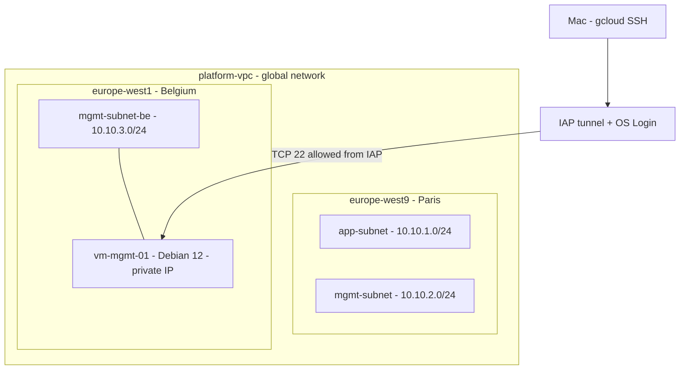

# Lab 1 - Google Cloud networking and a private VM with Terraform

Completed on 29 October 2026. The VM was deployed, accessed through SSH, inspected
with Linux networking tools, and deleted together with its boot disk. The network
and IAM foundation remains deployed.

## Objective and demonstrated skills

Build a Terraform-managed Google Cloud environment and administer a Debian VM
without a public IP address. Demonstrate the relationship between VPC, regional
subnets, firewall rules, IAM, IAP, and OS Login, then remove temporary resources.

This report uses terminal output from the session and the repository configuration.
Excerpts are shortened and omit personal login names and private credentials.
Observations are separated from architectural expectations and future work.

## Architecture



The diagram shows the environment during the session; the VM has since been
deleted. No application VM was deployed in either Paris subnet in this lab.

| Component | Configuration |
|---|---|
| VPC | `platform-vpc`, custom subnets, `REGIONAL` routing mode |
| Application subnet | `app-subnet`, `10.10.1.0/24`, `europe-west9` |
| Paris management subnet | `mgmt-subnet`, `10.10.2.0/24`, `europe-west9` |
| Belgium management subnet | `mgmt-subnet-be`, `10.10.3.0/24`, `europe-west1` |
| Temporary VM | `vm-mgmt-01`, `e2-micro`, `europe-west1-b`, Debian 12 |
| Boot disk | `pd-standard`, 10 GB, deleted with the VM |
| Observed VM address | `10.10.3.2`, no public IP |
| VM identity | Dedicated service account `sa-mgmt-vm` |
| Administrator access | IAP tunnel with OS Login enabled |

## Access controls and design choices

The VM has no `access_config` block and therefore no external IPv4 address.
The `allow-iap-ssh` firewall rule allows TCP 22 from `35.235.240.0/20` to instances
with the `mgmt-server` network tag. Administrative access does not require
exposing SSH through a public VM address.

The configured administrator has `roles/iap.tunnelResourceAccessor` and
`roles/compute.osAdminLogin`. These control access to the tunnel and administrative
OS Login, respectively. Secure Boot, vTPM, and Integrity Monitoring are enabled.

The VM uses a dedicated service account with the `cloud-platform` OAuth scope.
That scope does not grant IAM roles by itself. The repository does not assign a
project role to the VM service account. Human login identity and VM workload
identity serve different purposes.

The `allow-mgmt-to-app` rule permits TCP 443 from `10.10.2.0/24` to instances tagged
`app-server`. It does not cover the Belgian `10.10.3.0/24` subnet. No application
HTTPS connection between these subnets was validated.

## Capacity issue and regional placement

A creation attempt in Paris failed with:

```text
The zone '.../europe-west9-c' does not have enough resources available
```

The message identifies insufficient available capacity for that zonal request.
It does not establish a Terraform syntax error.

The chosen response was to preserve the Paris subnets, add `mgmt-subnet-be` in
Belgium, and deploy the e2-micro VM there. This illustrates that a VPC is global
while subnets are regional; the network's `REGIONAL` dynamic routing setting does
not make the VPC itself a regional resource.

The corresponding deployment reported:

```text
Apply complete! Resources: 2 added, 0 changed, 0 destroyed.
```

These two additions were the Belgian subnet and VM, after the original foundation
had been created. This count is not the total number of lab resources.

## SSH access from the Mac

The command used was:

```bash
gcloud compute ssh vm-mgmt-01 \
  --zone=europe-west1-b \
  --project=cloud-platform-engineering-hs \
  --tunnel-through-iap
```

gcloud requested local SSH key generation on the first connection. The private
key remains on the Mac and must not be committed. The resulting session allowed
verification of the hostname, Linux user, and private IP address.

## Linux diagnostics and observed evidence

| Command | Observed result | What the evidence supports |
|---|---|---|
| `hostname` | `vm-mgmt-01` | Connected to the expected VM |
| `whoami` | Linux identity derived from the Google account | User session available through OS Login |
| `ip -4 addr show` | `ens4`, `10.10.3.2/32` | Private address configured in the guest OS |
| `ip route` | Default route through `10.10.3.1` | Next hop configured despite the `/32` guest address |
| `cat /etc/resolv.conf` | DNS server `169.254.169.254` | DNS resolver configured in the VM |
| `getent hosts metadata.google.internal` | `169.254.169.254` | Successful resolution of this internal name |
| `ping -c 3 10.10.3.1` | 3 packets sent, none received | No ICMP reply; insufficient evidence of a routing failure |
| `curl -I --connect-timeout 5 --max-time 10 https://example.com` | Timeout after approximately 5 seconds | HTTPS connection to that destination was not established |

Observed routing table excerpt:

```text
default via 10.10.3.1 dev ens4 proto dhcp src 10.10.3.2 metric 100
10.10.3.1 dev ens4 proto dhcp scope link src 10.10.3.2 metric 100
169.254.169.254 via 10.10.3.1 dev ens4 proto dhcp src 10.10.3.2 metric 100
```

The guest `/32` and subnet `/24` describe different layers: the guest OS interface
configuration and the Google Cloud subnet address range. The explicit link route
to the gateway explains how the guest selects that next hop.

A default route and successful DNS resolution do not establish working Internet
egress. The observed timeout is consistent with a VM without a public IP and no
Cloud NAT or proxy configured in this lab. The timeout alone neither isolates the
exact cause nor tests every destination.

## Cleanup and cost awareness

The initial `terraform plan -destroy` only previewed deletion. A subsequent check
still showed the VM as `RUNNING` and its disk as present. The operational lesson
was that **planning deletion does not perform deletion**.

Targeted VM deletion was subsequently confirmed during the session. Checks while
preparing Lab 2 established:

- No instances, disks, or reserved IP addresses listed in the project.
- Nine permanent resources retained in Terraform state.
- Valid Terraform configuration and no foundation changes in the stop plan.

These checks are not an inventory of every Google Cloud service or proof of zero
charges. Remaining trial credits and their expiration must be checked in Cloud
Billing. See [costs and session cleanup](../README.md#costs-and-session-cleanup).

## Reproducing the lab with the current code

Lab 2 made the VM optional and disabled it by default. Its Terraform address is
now `google_compute_instance.mgmt_vm[0]`; historical Lab 1 plans used the address
without `[0]`.

From the existing repository root, with its local state and Google Cloud access:

```bash
./scripts/lab-status
./scripts/lab-start --plan
```

After checking trial credits and reviewing the plan, `./scripts/lab-start` prompts
for confirmation before creation. Repeat the SSH connection and Linux diagnostics
above, then clean up:

```bash
./scripts/lab-stop --plan
./scripts/lab-stop
./scripts/lab-status
```

The scripts reject foundation changes and VM replacements. Use them for routine
sessions instead of a global destroy or historical targeted commands. Do not
apply from a fresh clone without restoring the existing state. Automatic shutdown
is not implemented.

## Outcomes and remaining work

This lab demonstrates Terraform provisioning, multi-region subnet placement,
private VM administration, and evidence-based Linux network troubleshooting.
It also demonstrates cleanup verification and the difference between DNS, routing,
firewall permissions, and outbound connectivity.

Lab 2 adds lifecycle scripts and foundation protections. Independent states,
a remote backend, application connectivity from Belgium, and automatic shutdown
remain future work. See [architecture and operational notes](architecture-notes.md) for
questions grounded in this implementation.
