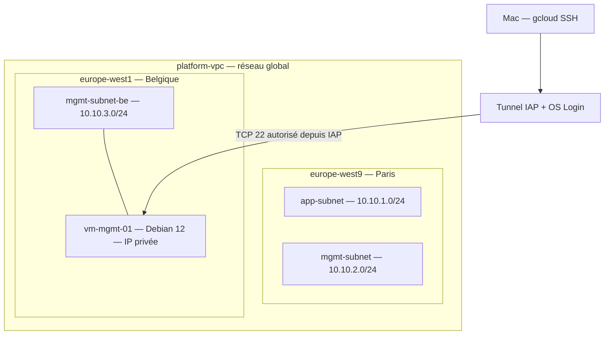

# LAB 1 — Réseau GCP et VM privée avec Terraform

Réalisé le 29 octobre 2026. Statut : VM déployée, accès SSH vérifié, diagnostics
réseau réalisés, puis VM et disque supprimés. Le socle réseau et IAM est conservé.

## Objectif

Construire une première infrastructure Google Cloud avec Terraform et administrer
une VM Debian sans adresse IP publique. Comprendre les liens entre VPC, subnets,
pare-feu, IAM, IAP et OS Login, puis nettoyer les ressources temporaires.

Ce compte rendu s'appuie sur les sorties terminal de la séance et sur la
configuration du dépôt. Les extraits ci-dessous sont abrégés ; aucun état
Terraform, identifiant ou clé privée n'est publié.

## Architecture réalisée



Le diagramme représente le lab pendant la séance ; la VM est maintenant supprimée.
Les deux subnets parisiens ne contiennent pas de VM applicative dans cet exercice.

| Composant | Configuration |
|---|---|
| VPC | `platform-vpc`, subnets personnalisés, routage `REGIONAL` |
| Subnet applicatif | `app-subnet`, `10.10.1.0/24`, `europe-west9` |
| Subnet de management Paris | `mgmt-subnet`, `10.10.2.0/24`, `europe-west9` |
| Subnet de management Belgique | `mgmt-subnet-be`, `10.10.3.0/24`, `europe-west1` |
| VM temporaire | `vm-mgmt-01`, `e2-micro`, `europe-west1-b`, Debian 12 |
| Disque de démarrage | `pd-standard`, 10 Go, suppression avec la VM |
| Adresse de la VM observée | `10.10.3.2`, sans IP publique |
| Identité de la VM | Service account dédié `sa-mgmt-vm` |
| Accès administrateur | Tunnel IAP, OS Login activé |

## Accès et règles de sécurité

La VM ne déclare pas de bloc `access_config` : elle n'a pas d'adresse IPv4 externe.
Le pare-feu `allow-iap-ssh` autorise TCP 22 depuis `35.235.240.0/20` vers les VM
portant le tag `mgmt-server`.

L'utilisateur administrateur dispose dans le code des rôles
`roles/iap.tunnelResourceAccessor` et `roles/compute.osAdminLogin`.
La VM utilise un compte de service dédié et le scope `cloud-platform` ; ce scope
ne constitue pas, à lui seul, une attribution de rôle IAM. Le code du dépôt
n'attribue pas de rôle projet à ce compte de service.

Secure Boot, vTPM et Integrity Monitoring sont activés.

La règle `allow-mgmt-to-app` autorise TCP 443 depuis `10.10.2.0/24` vers les VM
portant le tag `app-server`. Elle ne couvre pas le subnet belge `10.10.3.0/24`.
Aucun test applicatif HTTPS entre ces subnets n'a été validé dans ce lab.

## Déploiement et problème rencontré

Une tentative de création à Paris a échoué avec le message :

```text
The zone '.../europe-west9-c' does not have enough resources available
```

Cette erreur indique un manque de capacité disponible dans la zone pour la
requête. Elle ne démontre pas une erreur de syntaxe Terraform.

La solution retenue a été de conserver les subnets parisiens et d'ajouter
`mgmt-subnet-be` en Belgique, puis d'y déployer la VM `e2-micro`.
Le VPC est global ; chaque subnet appartient à une région.

La sortie de cette étape a confirmé :

```text
Apply complete! Resources: 2 added, 0 changed, 0 destroyed.
```

Ces deux créations correspondaient au subnet belge et à la VM, après création
du socle initial. Ce compteur ne décrit pas la totalité des ressources du lab.

## Connexion SSH depuis le Mac

La commande utilisée était :

```bash
gcloud compute ssh vm-mgmt-01 \
  --zone=europe-west1-b \
  --project=cloud-platform-engineering-hs \
  --tunnel-through-iap
```

Lors de la première connexion, gcloud a demandé la génération d'une paire de
clés SSH locale. La clé privée reste sur le Mac et ne doit pas être versionnée.
La session obtenue a permis de vérifier `hostname`, `whoami` et l'adresse privée.

## Vérifications Linux et résultats observés

| Commande | Résultat observé | Conclusion limitée au test |
|---|---|---|
| `hostname` | `vm-mgmt-01` | Session ouverte sur la VM attendue |
| `whoami` | Identité Linux dérivée du compte Google | Session utilisateur accessible via OS Login |
| `ip -4 addr show` | `ens4`, `10.10.3.2/32` | Adresse privée configurée dans le système invité |
| `ip route` | Route par défaut via `10.10.3.1` | Prochain saut configuré malgré le masque `/32` |
| `cat /etc/resolv.conf` | DNS `169.254.169.254` | Résolveur configuré dans la VM |
| `getent hosts metadata.google.internal` | `169.254.169.254` | Résolution de ce nom interne fonctionnelle |
| `ping -c 3 10.10.3.1` | 3 paquets envoyés, 0 reçu | Pas de réponse ICMP ; cela ne suffit pas à conclure à une panne de routage |
| `curl -I --connect-timeout 5 --max-time 10 https://example.com` | Timeout après environ 5 secondes | Connexion HTTPS à cette destination non établie |

Extrait de la table de routage :

```text
default via 10.10.3.1 dev ens4 proto dhcp src 10.10.3.2 metric 100
10.10.3.1 dev ens4 proto dhcp scope link src 10.10.3.2 metric 100
169.254.169.254 via 10.10.3.1 dev ens4 proto dhcp src 10.10.3.2 metric 100
```

L'interface en `/32` et le subnet en `/24` décrivent deux niveaux différents :
la configuration de l'OS et la plage du subnet GCP. La route explicite vers la
passerelle explique comment l'OS peut l'atteindre.

La route par défaut et une résolution DNS fonctionnelle ne prouvent pas un accès
Internet sortant. Le timeout observé est cohérent avec une VM sans IP publique
et l'absence de Cloud NAT ou de proxy configuré dans le lab ; il ne constitue pas,
à lui seul, une preuve de la cause exacte ni un test de toutes les destinations.

## Nettoyage et maîtrise des dépenses

Le premier `terraform plan -destroy` a seulement affiché un plan : la VM était
encore `RUNNING` et le disque encore présent lors de la vérification suivante.
La distinction apprise est que **planifier une suppression ne la réalise pas**.

La suppression ciblée de la VM a ensuite été confirmée pendant la séance.
Les vérifications réalisées lors de la préparation du LAB 2 ont constaté :

- aucune VM, aucun disque ni aucune adresse IP réservée listés dans le projet ;
- neuf ressources permanentes conservées dans l'état Terraform ;
- configuration Terraform valide et socle sans changement dans le plan d'arrêt.

Ces contrôles ne constituent pas un inventaire de tous les services GCP ni une
preuve d'absence totale de frais. Le solde et la date d'expiration des crédits
restent à vérifier dans Cloud Billing. Les détails sont dans le [README](../README.md#coûts-et-fin-de-session).

## Rejouer le lab avec la version actuelle

Le code a évolué pendant le LAB 2 : la VM est maintenant optionnelle, désactivée
par défaut, et son adresse Terraform est `google_compute_instance.mgmt_vm[0]`.
Les anciens plans du LAB 1 utilisaient l'adresse sans `[0]`.

Depuis la racine du dépôt existant, avec son état local et les accès GCP :

```bash
./scripts/lab-status
./scripts/lab-start --plan
```

Après vérification des crédits et du plan, `./scripts/lab-start` propose la
création avec confirmation. La connexion SSH et les commandes Linux ci-dessus
peuvent alors être rejouées. Pour terminer :

```bash
./scripts/lab-stop --plan
./scripts/lab-stop
./scripts/lab-status
```

Les scripts refusent les changements du socle et les remplacements de VM.
Ne pas réutiliser une destruction globale ou les anciennes commandes ciblées
comme procédure quotidienne. Ne pas appliquer depuis un clone sans restaurer
l'état existant. Aucun arrêt automatique n'est installé.

## Compétences mises en pratique et suites

- Décrire et provisionner une infrastructure avec Terraform.
- Distinguer réseau global et subnets régionaux.
- Administrer une VM privée avec IAP et OS Login.
- Examiner les adresses, les routes et la résolution DNS sous Linux.
- Distinguer route, autorisation réseau et accès Internet sortant.
- Vérifier un plan et supprimer les ressources temporaires après une séance.

Le LAB 2 ajoute les scripts de cycle de vie et les protections du socle.
La séparation en deux états Terraform, un backend distant, la correction du flux
HTTPS depuis la Belgique et l'arrêt automatique restent des évolutions possibles ;
ils ne sont pas présentés comme réalisés dans ce compte rendu.
