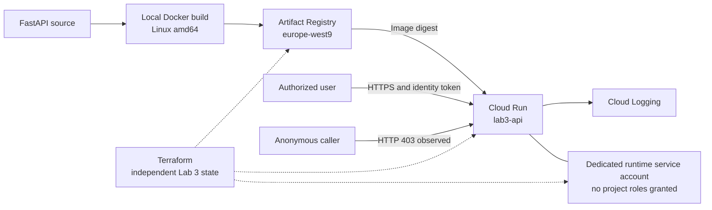

# Lab 3 — Containerized API on Cloud Run

**Status:** one live build, publish, deploy, authenticated access, and cleanup
cycle completed on 29 October 2026. No live service is kept running.

## Objective

Package a Python API as a container, publish it to a private registry, and run
it on Google Cloud without administering application servers. Extend the
preview-first lifecycle introduced in Lab 2 while giving this workload an
independent Terraform state and a dedicated runtime identity.

## Architecture

Cloud Run has a public network endpoint with IAM-authenticated invocation.
This is not private VPC ingress. No `allUsers` binding is created. The operator's
existing inherited permissions allowed the test call; the runtime account is
separate from the caller and is not granted project roles by this lab.
The application does not call other Google Cloud APIs.

## Implementation and decisions

| Component | Implementation | Reason |
|---|---|---|
| API | FastAPI: `GET /health`, `GET /`; `APP_ENV` configuration | Small workload with observable health and environment behavior |
| Container | Python 3.12 slim, Linux amd64, user 10001, `0.0.0.0:$PORT` | Match Cloud Run's runtime contract and avoid a root application process |
| Build context | Allow only requirements and application source | Keep local credentials, Terraform state, and development files out of the image context |
| Registry | Dedicated Docker repository in Paris | Store the workload separately and delete its images with the lab |
| Image reference | SHA-256 digest | Deploy the tested content rather than relying on a mutable tag |
| Runtime | Cloud Run v2; 1 CPU, 256 MiB, request-based CPU allocation | Small, temporary serverless workload |
| Scaling | Service minimum 0, maximum 1; concurrency 10, timeout 10 seconds | Reduce idle capacity and constrain the experiment; not a financial cap |
| State | Local state in `lab3/infra` | Clean up the workload without managing Lab 1/2 foundation resources |
| Lifecycle | Saved Terraform plan, address/action checks, explicit confirmation | Apply the reviewed plan and reject unexpected operations |

## Operating sequence

The [French guide](../lab3/README.md) contains prerequisites and complete commands.
Run all commands from the repository root.

1. Check the billing account remains on the free trial, with sufficient valid credits.
2. Run the API tests; build and test the Linux amd64 container locally.
3. Initialize `lab3/infra` using the committed provider lock file.
4. Preview `./lab3/lifecycle prepare`, then apply it with `--apply`.
5. Push the tested image and retrieve its digest.
6. Export `LAB3_IMAGE` with that digest; preview and apply `deploy`.
7. Check authenticated responses, reject anonymous access, and inspect logs.
8. Preview and apply `clean`, then verify the cloud inventories and state.

Without `--apply`, the lifecycle command only plans. Prepare and deploy permit
creation of known Lab 3 addresses; clean permits deletion. Updates and
replacements are rejected for manual investigation. This is a small lab guard,
not a comprehensive policy engine: it does not validate every resource setting
or enforce billing account status. Review the plan as well as the configuration.

Cleanup removes only resources tracked in the Lab 3 state. Do not delete that
state before successful cleanup, and do not use the foundation's Terraform root
for this operation. API activation resources use `disable_on_destroy = false`:
cleanup forgets their management but leaves the APIs enabled for other users.

## Observed evidence

| Check | Observed result |
|---|---|
| Local automated verification | 3 API tests and 6 plan guard tests passed |
| Lab 2 regression checks | All 7 existing guard tests passed; foundation configuration unchanged |
| Local image inspection | `linux/amd64`, runtime user `10001` |
| Local container HTTP checks | `/health` healthy; `/` returned `environment=docker` |
| Registry publication | Image pushed successfully and deployed by digest |
| Authenticated Cloud Run health | HTTP 200, `{"status":"ok"}` |
| Authenticated application endpoint | HTTP 200, `environment=lab3` |
| Anonymous health request | HTTP 403 |
| Logs | Uvicorn startup and listener on port 8080 observed |
| Cleanup | Service, repository including images, and runtime service account deleted |
| Repeat cleanup | No objects to destroy; no-change plan accepted by the guard |
| Final inventories | No Cloud Run services in Paris; no Artifact Registry repositories across locations; no matching runtime account |
| Compute inventory | No instances, disks, or reserved IP addresses returned |

The deployed image digest was
`sha256:47635b9c5738f40b3f04d8ee891af414d35642dc7e1659aac9d4ce2a1a9842d7`.
These results describe the recorded session, not continuous monitoring. A
no-change repeat cleanup plan was performed; a second cleanup apply was not needed.
Detailed session notes are available [in French](../lab3/RESULTATS.md).

## Cost controls and limitations

Trial status and credit validity were confirmed by the operator in the billing
console. CLI checks established an open linked billing account, not the trial
balance. The lab did not upgrade billing or change payment settings.
No Cloud Build, VM, NAT, load balancer, or VPC connector was added.

The deployment can consume trial credits for compute, requests, and image
storage. Minimum instances zero does not remove stored images. The service and
repository were deleted immediately after testing; logs can persist. Exact
consumption was not measured and billing reports may update later. The inventory
checks are not an audit of every Google Cloud product.

There is no automated shutdown, credit enforcement, load test, or observed
scale-to-zero measurement. Maximum instances is not a spending cap. The local
provider lock is committed; the base image tag and transitive Python dependencies
are not fully pinned. The macOS Python 3.9 dependency snapshot records the local
test environment and is not a cross-platform container lock file.
No remote state backend or CI/CD workflow is implemented.

## Design rationale

- **Why Cloud Run here?** It isolates container packaging, IAM, and deployment
  concepts before adding cluster administration in a later platform lab.
- **Why a separate runtime identity?** Workload permissions can be scoped
  independently of the deployer and the user who invokes the service.
- **Why use a digest?** A mutable tag can point to different content; a digest
  identifies the image used in this session.
- **Why delete the registry too?** Removing compute alone leaves image storage.
- **What would change for production?** Remote state and access controls, CI/CD,
  reproducible builds, vulnerability management, observability, recovery goals,
  and a reviewed IAM and cost-management design.

## References

- [Cloud Run container contract](https://docs.cloud.google.com/run/docs/container-contract)
- [Terraform Cloud Run v2 resource](https://registry.terraform.io/providers/hashicorp/google/latest/docs/resources/cloud_run_v2_service)
- [Google Cloud free trial billing rules](https://cloud.google.com/signup-faqs)
