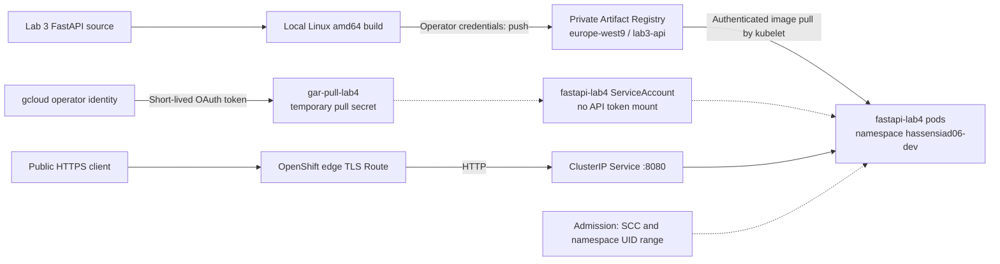

# Lab 4 - Private Google Cloud registry to OpenShift Developer Sandbox

**Status:** deployment and cleanup completed on 29 October 2026, as reported
by the operator. No live demo or registry image is retained. This report records
that session; the accompanying manifests are a reconstruction for future runs,
not an export of the original admitted objects. They have not been redeployed
as part of this documentation change.

## Objective and architecture

Run the Lab 3 FastAPI image on a different platform while separating image
publication, image-pull authorization, Kubernetes permissions, and Linux process
identity. See the [operating guide](../lab4/README.md) for the full sequence.



This is a hybrid delivery path between Google Cloud and a managed OpenShift
Sandbox, not a private network interconnection. Artifact Registry is private;
the application route is public, with no application authentication. TLS ends
at the OpenShift router. The application makes no GCP API calls.

## Implementation choices

| Component | Choice and implication |
|---|---|
| Source | Reuse `lab3/app` and Dockerfile without modifying Lab 3 |
| Image | Rebuild `api:lab3`, publish to `lab3-api`, resolve a new immutable digest |
| Workload | Deployment, ClusterIP Service, edge TLS Route, dedicated ServiceAccount; all named `fastapi-lab4` |
| Registry authentication | OAuth access token in `gar-pull-lab4`, referenced by ServiceAccount; no service account key file |
| Probes | Readiness and liveness use `/health` on port 8080 |
| Scaling | Manual 1→2→1; preferred anti-affinity encourages separate nodes |
| Update | Change `APP_ENV` to `openshift-lab4-v2`; preserve image and roll back template revision |
| RBAC | No workload RoleBinding; API token mount disabled; pull authorization is separate from API authorization |
| Linux security | No fixed UID; non-root, dropped capabilities, RuntimeDefault seccomp, privilege escalation disabled |
| Infrastructure | Reuse isolated `lab3/infra` preparation and guarded cleanup; no Cloud Run deployment needed |

The checked-in [manifest](../lab4/manifests/workload.yaml) contains no credentials
and intentionally requires replacement of `IMAGE_BY_DIGEST`. Resource sizing,
probes, anti-affinity and rollout settings are reproducible baseline choices;
they are not claimed as exact settings captured from the historical session.
No custom SCC, elevated SCC binding, cluster role, namespace or GCP IAM grant
is created by these manifests.

## Recorded evidence

The following results were supplied by the operator from the completed session.
Raw terminal logs are not included; these checks were not rerun during authoring.

| Check | Reported observation |
|---|---|
| Registry and target | `cloud-platform-engineering-hs`, `europe-west9`, repository `lab3-api`; namespace `hassensiad06-dev` |
| HTTP endpoints | `/health` and `/` succeeded over HTTPS |
| Manual scaling | Two Ready pods (2/2), distributed across two nodes; scaling 1→2→1 succeeded |
| Rolling update | `APP_ENV=openshift-lab4-v2` update succeeded |
| Rollback | Previous application configuration restored successfully |
| RBAC | Workload ServiceAccount could neither create deployments nor read secrets |
| SCC and UID | `restricted-v2`; effective UID `1004890000` |
| Process restrictions | `NoNewPrivs=1`, `CapEff=0`, `CapBnd=0`, `allowPrivilegeEscalation=false` |
| OpenShift cleanup | Lab 4 resources removed; existing applications were outside scope |
| GCP cleanup | Zero Artifact Registry repositories and zero Cloud Run services in `europe-west9` |
| Terraform cleanup | `terraform -chdir=lab3/infra state list` returned no resources |

The historical image reference was:

```text
europe-west9-docker.pkg.dev/cloud-platform-engineering-hs/lab3-api/api@sha256:47635b9c5738f40b3f04d8ee891af414d35642dc7e1659aac9d4ce2a1a9842d7
```

**That image has been deleted.** Do not deploy this historical reference. Build
and push a fresh image, retrieve its digest, then render the manifest using that
new value. The newly built image can have a different digest.

## Security boundaries and limits

The GCP identity authorizes registry access. The OpenShift ServiceAccount defines
the pod identity and references the pull secret; SCC admission determines allowed
process settings. Kubernetes RBAC and the Linux UID are separate controls.
No project-wide role or SCC escalation is needed for the workload.

An OAuth token normally lasts 60 minutes. Expiry affects later image pulls,
including rescheduling and rollbacks; a running pod does not demonstrate that
future pulls will succeed. The guide renews the secret without placing the
token in shell arguments, repository files or terminal output. The cluster secret
still holds a sensitive credential until deletion. A production design would
need managed credential renewal or a reviewed federation integration, repository
scoped reader identity, and secret lifecycle controls.

The observed UID belongs to this namespace's allocation and must not be hardcoded.
SCC selection can change with the Sandbox version and grants; inspect admitted
pods. The image must tolerate an arbitrary non-root UID. Here it reads application
code, listens on an unprivileged port and requires no writable application tree.

Two-node placement is an observation, not a Sandbox availability guarantee.
There is no HPA, load test, downtime measurement, production availability claim,
network policy, private ingress or end-to-end TLS implementation. Developer
Sandbox quotas and expiry can constrain or remove the environment.

Cleanup covers named Lab 4 objects and resources managed by the separate Lab 3
state. It does not audit other regions, projects or products and does not establish
zero billing. Never destroy Lab 1/2 state or delete the shared Sandbox namespace.

## References

- [Google Cloud: Docker authentication and short-lived access tokens](https://docs.cloud.google.com/artifact-registry/docs/docker/authentication)
- [Google Cloud: pushing and pulling images](https://docs.cloud.google.com/artifact-registry/docs/docker/pushing-and-pulling)
- [Red Hat: SCC strategies and namespace UID allocation (OpenShift 4.11)](https://docs.redhat.com/en/documentation/openshift_container_platform/4.11/html/authentication_and_authorization/managing-pod-security-policies)

Consult documentation matching the current Sandbox version before rerunning.
