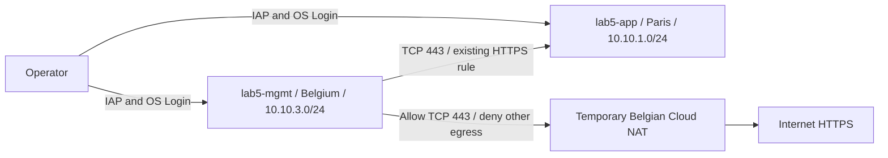

# Lab 5 - Private networking and controlled egress

## Objective

Diagnose and repair private HTTPS connectivity from the Belgian management
subnet to the Paris application subnet. Distinguish VPC routing, ingress
firewalls, internet routes, NAT and egress policy through real positive and
negative tests. Completed on 30 October 2026; temporary resources cleaned up.

## Architecture



The VPC is global. Existing subnet routes already connect these regions; regional
dynamic routing mode does not disable subnet connectivity. The existing default
internet route did not give private instances internet access without NAT.
Neither probe had an external address or an attached service account.

## Decisions

- Preserve the three subnets, VPC, IAP rule and existing IAM foundation.
- Extend `allow-mgmt-to-app` source ranges from `10.10.2.0/24` to also include
  `10.10.3.0/24`; keep target tag `app-server` and TCP port 443.
- Put temporary resources in independent local state at `lab5/infra`, referencing
  existing network IDs without importing or managing foundation resources.
- Use e2-micro and auto-deleted 10 GB pd-standard boot disks, with short sessions.
- Restrict NAT to the Belgian subnet primary range. An allow rule at priority
  900 permits TCP 443 and a deny-all rule at 1000 restricts only the probe tagged
  `lab5-egress`. NAT itself is not a destination firewall.
- Use an OpenSSL HTTPS listener with a one-day self-signed certificate. Internal
  curl uses `-k` to isolate reachability; it does not establish server identity.
  External HTTPS retains certificate verification.

## Implementation

See [Terraform](../lab5/infra/main.tf), [listener](../lab5/https-server.sh), and
[probes](../lab5/probe.sh). From the repository root:

```bash
terraform -chdir=lab5/infra init -lockfile=readonly
terraform -chdir=lab5/infra validate
# Use a private directory outside Git for saved plans.
umask 077
session_dir=$(mktemp -d)
terraform -chdir=lab5/infra plan -out="$session_dir/private-vms"
# Inspect: exactly two private VMs, no foundation changes.
terraform -chdir=lab5/infra apply "$session_dir/private-vms"
terraform -chdir=lab5/infra output probe_ips

gcloud compute ssh lab5-app --project=cloud-platform-engineering-hs \
  --zone=europe-west9-b --tunnel-through-iap --command='bash -s' < lab5/https-server.sh
# Substitute the current app IP from Terraform; historical addresses are not fixed.
gcloud compute ssh lab5-mgmt --project=cloud-platform-engineering-hs \
  --zone=europe-west1-b --tunnel-through-iap \
  --command='bash -s -- APP_PRIVATE_IP' < lab5/probe.sh

terraform -chdir=lab5/infra plan -var=nat_enabled=true -out="$session_dir/nat"
# Inspect: four additions (router, NAT, two egress rules).
terraform -chdir=lab5/infra apply "$session_dir/nat"
# Repeat probes from Belgium; also test external HTTPS from the Paris VM.
```

The foundation rule correction was reviewed separately: zero additions, one
in-place firewall update, zero deletions. Its current configuration already
contains the correction; a rerun should not expect the original denial unless
using a separate test rule/environment. Do not revert shared foundation rules
merely to reproduce historical evidence. Existing Lab 2 lifecycle guards reject
firewall changes by design.

## Actual observed evidence

| Check on 30 October 2026 | Observation |
|---|---|
| Initial foundation plan | No changes across all nine managed resources |
| Baseline Belgium to Paris HTTPS | HTTP 000, curl exit 28 (timeout) |
| Baseline external HTTPS from Belgium | HTTP 000, curl exit 28 |
| After source-range correction | Private HTTPS HTTP 200; external HTTPS still timed out |
| NAT and egress policy active | Private HTTPS HTTP 200; external HTTPS HTTP 200 |
| External HTTP from Belgium | HTTP 000, curl exit 28 under HTTPS-only policy |
| External HTTPS from Paris | HTTP 000, curl exit 28; Paris subnet excluded from NAT |
| Temporary resource plans | Initial two creates; NAT four creates and one probe tag update |
| Cleanup apply | Six resources deleted from Lab 5 state; boot disks auto-deleted |

The first IAP attempts occurred before guest SSH was ready. Subsequent failures
were caused by a passphrase-protected local key without an interactive prompt;
verbose SSH showed the server accepted the public key. A temporary key outside
Git, registered with an OS Login expiry, enabled the observed tests. The key was
removed after testing. A short diagnostic startup script was removed. The gcloud
SSH diagnostic enabled Network Management API and created a Connectivity Test;
that named test was deleted. IAP and IAM Credentials APIs were also enabled.
No existing API was disabled.

## Cleanup

```bash
terraform -chdir=lab5/infra plan -destroy -var=nat_enabled=true -out="$session_dir/cleanup"
# Review exactly the Lab 5 resources before applying.
terraform -chdir=lab5/infra apply "$session_dir/cleanup"
terraform -chdir=lab5/infra state list
# Repeat inventories: no lab5 instances, disks, router or temporary firewall rules.
./scripts/lab-status
rm -rf "$session_dir"
```

`-destroy` here is confined to the isolated Lab 5 state. Never run it against
`terraform/environments/dev`. Keep state until successful cleanup. The permanent
HTTPS source-range addition remains; no global destroy or shared billing-account
change was performed.

## Limitations

HTTP timeout plus HTTPS success validates these paths in this session; it is
not exhaustive protocol coverage. HTTPS is allowed to any destination, with no
FQDN filtering, TLS inspection or exfiltration prevention. Google metadata/DNS
traffic and stateful response handling have platform-specific behavior. NAT is
subnet scoped, so another VM in that subnet could use its temporary translation
path; only the lab probe receives the new egress firewall restrictions.

Billing linkage was checked, but current trial credit balance and expiration
were not verified in the console during this session. Resource duration and
cleanup limited exposure; exact charges were not measured. No budget enforcement
or automatic timeout was implemented. No Technical Copilot resources were managed.

## Interview takeaways

- Explain why a default route, a firewall allow and a NAT gateway solve different
  parts of connectivity; demonstrate the timeout/200 transitions.
- Explain why a global VPC connects regional subnets without peering.
- Describe why NAT does not enforce HTTPS and why port 443 is not an application
  allowlist or protection against data exfiltration.
- Distinguish reachability verification from certificate identity verification.
- Explain isolated state cleanup and why permanent rule changes need a separate plan.

## References

- [Public NAT](https://docs.cloud.google.com/nat/docs/public-nat)
- [VPC firewall rules](https://docs.cloud.google.com/firewall/docs/firewalls)
- [SSH troubleshooting](https://docs.cloud.google.com/compute/docs/troubleshooting/troubleshooting-ssh-errors)
