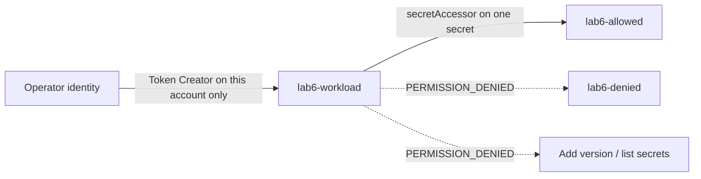

# Lab 6 - Least-privilege IAM and Secret Manager

## Objective

Prove that a dedicated workload identity can read one specific secret while
failing to read another, write a version, or list project secrets. The real
authorization tests ran on 30 October 2026. Secret payloads were never committed
or supplied to Terraform.

## Architecture



## Decisions

Use an independent local state in `lab6/infra`. Terraform creates the service
account, two secret containers and additive IAM memberships. The workload has
no project role; `roles/secretmanager.secretAccessor` is bound only to
`lab6-allowed`. The human's Token Creator grant is on this temporary service
account, not the project. No persistent service-account key is created.

Use short-lived impersonation to exercise the workload's actual IAM principal.
This separates secret authorization from VM network access and runtime wiring.
A VM-attached or Cloud Run runtime identity was not deployed in this lab.
Impersonation is a testing/delegation capability and must itself be tightly
controlled: an authorized impersonator can exercise the target's permissions.

## Implementation

[Terraform](../lab6/infra/main.tf) manages no secret versions. The
[verifier](../lab6/verify.py) generates random canaries, uploads them over stdin
using the operator, then reads and compares the allowed value without logging
it. A private temporary directory holds the exact-byte download and is removed
on exit. The script captures command output and prints only test outcomes.

```bash
umask 077
session_dir=$(mktemp -d)
terraform -chdir=lab6/infra init -lockfile=readonly
terraform -chdir=lab6/infra validate
terraform -chdir=lab6/infra plan -out="$session_dir/create"
# Review six additions, no changes to existing resources.
terraform -chdir=lab6/infra apply "$session_dir/create"
# IAM Credentials API must be enabled; allow IAM bindings time to propagate.
python3 lab6/verify.py
```

The source currently names this portfolio's operator account. Review the
operator binding before adapting the lab to a different project or identity.
Each verifier rerun adds fresh canary versions; clean up afterward.

## Actual observed evidence

| Check on 30 October 2026 | Observation |
|---|---|
| Operator creates canary versions | Both uploads succeeded |
| Workload reads `lab6-allowed` | Succeeded; exact bytes matched the generated canary |
| Workload reads `lab6-denied` | PERMISSION_DENIED |
| Workload adds a version to `lab6-allowed` | PERMISSION_DENIED |
| Workload lists project secrets | PERMISSION_DENIED |
| IAM policy inspection | Secret accessor on allowed secret only; Token Creator on dedicated account only |
| Cleanup | Six tracked resources deleted; subsequent matching secret/account inventories and state list empty |

Initial impersonation failed while the new bindings propagated. A later allowed
read succeeded, but an early binary-output comparison failed. The verifier was
corrected to use the CLI's exact-byte `--out-file` path and ASCII canaries, then
the full test sequence passed. These failures are not counted as successful
negative authorization tests. The final negative checks ran after a successful
impersonated read and required the explicit PERMISSION_DENIED error class.

## Cleanup

```bash
terraform -chdir=lab6/infra plan -destroy -out="$session_dir/cleanup"
# Review six deletions in this state only; API remains enabled.
terraform -chdir=lab6/infra apply "$session_dir/cleanup"
terraform -chdir=lab6/infra state list
# Check matching secret and identity inventories after successful apply.
gcloud secrets list --project=cloud-platform-engineering-hs --filter='name:lab6-'
gcloud iam service-accounts list --project=cloud-platform-engineering-hs --filter='email:lab6-workload'
rm -rf "$session_dir"
```

Deleting the two temporary secrets removes their test versions. The dedicated
identity, secret binding and temporary impersonation binding are also removed.
`disable_on_destroy=false` leaves the API enabled rather than disrupting other
project users. No foundation IAM grants or Technical Copilot resources are
managed. Never run cleanup against the foundation root.

## Limitations

This is principal-level API authorization evidence, not an application runtime
integration, rotation rollout, audit-log review or VPC Service Controls test.
No genuine application credential was used. Project administrators can still
change IAM; secret-level isolation does not override independently inherited
permissions. Capture failures before changing permissions rather than granting
broad roles to make a test pass.

Secret versions and API calls can incur small charges. Exact usage and current
trial balance were not measured; immediate deletion limits exposure and is not
a financial cap. Payloads can exist in CLI memory and a private temporary file
during verification; suppressing output does not eliminate those locations.

## Interview takeaways

- Distinguish the operator, an impersonated workload principal and a runtime's
  attached identity; no service-account key is required for this test.
- Explain why secret-level accessor does not grant version writes or listing.
- Use positive and negative tests with valid existing target secrets to avoid
  confusing missing resources, API errors and authorization failures.
- Explain IAM propagation, secret payload handling and cleanup of test versions.

## References

- [Secret Manager access control](https://docs.cloud.google.com/secret-manager/docs/access-control)
- [Service account impersonation](https://docs.cloud.google.com/iam/docs/service-account-impersonation)
