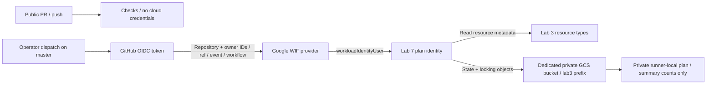

# Lab 7 - Keyless GitHub Actions checks and Terraform plans

## Objective

Authenticate GitHub Actions to Google Cloud using Workload Identity Federation,
validate the actual repository roots, and plan against the real Lab 3 state.
Do not create or store a service-account JSON key. Live CI checks, a cloud plan
and a rejected untrusted-branch authentication were verified on 30 October 2026.

## Architecture



## Decisions and state boundaries

Repository inspection established that Labs 1/2 use one local foundation state,
Lab 3 had a separate empty local state, and Lab 4 reuses Lab 3 infrastructure
without another Terraform module. There are no shared modules. Lab 7 migrates
only the empty Lab 3 state to `gs://cpe-hs-lab3-state-565473613966/lab3/default.tfstate`.
The foundation, Labs 5/6, and `lab7/bootstrap` keep separate local states.

The dedicated regional bucket enforces uniform access and public-access
prevention. Versioning retains recoverable state versions; archived versions
expire after seven days. `prevent_destroy` and `force_destroy=false` protect the
bucket. State access uses a bucket-scoped objectAdmin binding because Terraform
must create/delete lock objects. This permits modification of this bucket's
state objects: the identity is read-only for infrastructure APIs, not for state.
Only this isolated lab's state belongs in the bucket. Never store secrets there.

The workflow also checks effective project permissions using the non-mutating
[permission probe](../lab7/check-permissions.py). The custom project role contains only get/list permissions for Lab 3 resource
types, Service Usage and project metadata. It can read those resource types
across this portfolio project; it does not write infrastructure, read Secret
Manager payloads or grant IAM. No role is granted in Technical Copilot or on the
shared billing account. OIDC trust requires numeric repository ID `1438231492`,
numeric owner ID `10074904`, `refs/heads/master`, event `workflow_dispatch` and
the exact `cloud-plan.yml` workflow path/ref. Numeric IDs reduce name-reuse risk.

Public pull requests and pushes run only credential-free checks. The cloud plan
workflow requires a manual dispatch on master. Its GitHub token gets `id-token:
write` only in the cloud job and `contents: read`. Actions are pinned to commit
SHAs. Checkout does not persist Git credentials. No `pull_request_target` event,
public plan artifact, JSON key secret, or CI apply job is used.

## Implementation and operating guide

1. Initialize `lab7/bootstrap`, review its eight-resource plan and apply it as
   the operator. Keep the bootstrap state private and backed up. It manages only
   the dedicated bucket, plan identity, custom role/bindings, pool and provider.
2. Back up and inspect the old Lab 3 state privately. Verify it has no resources
   after Labs 3/4 cleanup; preserve its lineage. Do not migrate foundation state.
3. Add the checked-in `lab3/infra/backend.tf`, then run:

   ```bash
   terraform -chdir=lab3/infra init -migrate-state -lockfile=readonly
   terraform -chdir=lab3/infra state list
   ```

   Terraform may skip copying a completely empty state. In this session the
   inspected empty state was explicitly pushed with `terraform state push`
   without `-force`; the remote object was then listed and resource count checked.
   Never force-push an older state over an existing deployed environment.
4. Run local checks, publish the reviewed source, then dispatch:

   ```bash
   gh workflow run cloud-plan.yml --ref master
   gh run list --workflow cloud-plan.yml
   gh run view RUN_ID
   ```

The cloud job initializes the real backend, validates Lab 3 and plans
`deploy=false`. With empty state it should propose three API management resources,
one registry and one runtime identity; it does not deploy Cloud Run. API services
may already be enabled: a create action here establishes Terraform management,
not proof the service was previously disabled. The existing Lab 3 guard rejects
unexpected updates, replacements, addresses and Cloud Run deployment in prepare.

Plans, plan JSON and logs remain in a private runner directory and are deleted
by an exit trap. Only action counts are written to the GitHub summary. The auth
action removes its short-lived credential file during post-job cleanup; the
filename is also ignored by Git. A plan failure currently reports a generic
error to avoid exposing private plan output in this public repository.

## Apply protection

There is no automated apply path and no infrastructure write permission on the
CI account. An operator must run the existing reviewed-plan Lab 3 lifecycle
locally; its confirmation remains required for manual runs. A CI plan is neither
an approved apply artifact nor a deployment claim. A future CI apply design needs
a distinct identity, protected environment with required reviewers, restricted
branch/environment claims, a reviewed private plan handoff and narrowly scoped
write permissions. Those capabilities are deliberately not granted here.

## Actual observed evidence

| Check on 30 October 2026 | Observation |
|---|---|
| [Repository checks](https://github.com/chmod777/cloud-platform-engineering/actions/runs/41033487379) | Success on commit `b9df0cf`: all five roots validate on Linux, formatting and shell checks pass, seven lifecycle tests and nine API/Lab 3 guard tests pass |
| [Keyless cloud plan](https://github.com/chmod777/cloud-platform-engineering/actions/runs/41033487282) | Success on `b9df0cf`: OIDC exchange, 300-second access token, actual GCS backend initialization, state locking, validation and plan guard all passed |
| Guarded prepare plan | Exactly five create actions; no apply executed and no Cloud Run service planned |
| Effective permission inspection | `projects.testIamPermissions` returned the expected project-read permission and none of the tested Cloud Run create, registry create, service-account create, project IAM write or secret payload permissions |
| [Untrusted-branch test](https://github.com/chmod777/cloud-platform-engineering/actions/runs/41033368479) | Authentication failed at Google STS with `unauthorized_client`: credential rejected by the attribute condition |
| No persistent key | User-managed key inventory for the CI service account returned no entries |
| Backend inventory | One 457-byte current state object, no lingering lock object; Lab 3 resource list remains empty |
| Bootstrap convergence | Live plan reported no changes |

The untrusted-branch test temporarily removed only the workflow's local master
job gate on a test branch so that Google, rather than a skipped GitHub job,
would evaluate the token. Both ref and workflow-ref claims differed from the
allowed values, so this proves rejection of that combined untrusted context;
it does not isolate every claim independently. The default branch policy was
unchanged and the temporary remote branch was deleted afterward.

The first Linux runs authenticated successfully but failed provider validation
because the existing lock recorded only the Mac package content hash. Terraform
retrieved signed checksums for `darwin_arm64` and `linux_amd64`; the Linux hash
was added to all five identical provider locks, retaining version 7.46.2. The
subsequent checks and cloud plans passed. The first workflow dispatch also
returned 404 while GitHub indexed the new workflow; retry after registration
succeeded. These initial failures are retained in GitHub run history.

The permission check is non-mutating introspection, not a series of attempted
resource creations. Empty Lab 3 state means the plan validates creation intent
and backend access, not refresh of a running Cloud Run service. No production
apply or deployment is claimed.

## Cleanup and retained resources

Labs 5/6 temporary resources and Lab 3 workloads remain cleaned up. The state
bucket, tiny state object, plan identity, custom role and federation remain as
portfolio infrastructure. Storage operations and retained versions can incur
small charges; no compute, registry image or NAT is needed for these CI plans.
The bucket is intentionally retained to preserve authoritative remote state.

Do not run bootstrap destroy or delete the bucket while Lab 3 uses it. To retire
this setup, first back up and deliberately migrate Lab 3 state to a reviewed
replacement backend, disable cloud dispatch/federation, remove scoped bindings
and identities, then explicitly review removal of bucket protection and all
object versions. No global destroy is part of this lab.

## Limitations and interview takeaways

This lab demonstrates keyless checks and plans, not CI deployment, branch
protection enforcement, disaster recovery restoration or a production delivery
platform. A maintainer who can change trusted workflow source can use the plan
identity's permissions, including state-object writes. Pinning actions and
restricting OIDC claims do not substitute for repository governance.

Explain the GitHub token, OIDC token, WIF external principal and service account
as separate identities/credentials. Explain why local foundation state cannot
be replaced by an empty runner state, why state write access matters even for
planning, why an API management create can appear for an enabled API, and why
plan success does not establish runtime behavior or apply authorization.

## References

- [Google Cloud deployment pipeline federation](https://docs.cloud.google.com/iam/docs/workload-identity-federation-with-deployment-pipelines)
- [Terraform GCS backend](https://developer.hashicorp.com/terraform/language/backend/gcs)
- [Google GitHub Actions auth](https://github.com/google-github-actions/auth)
